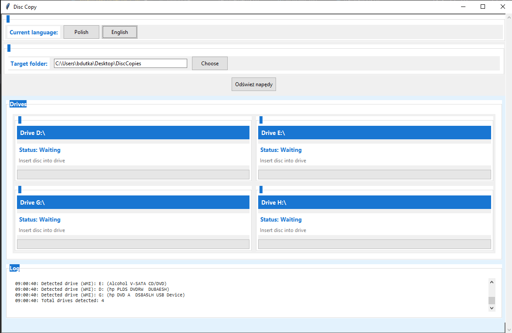
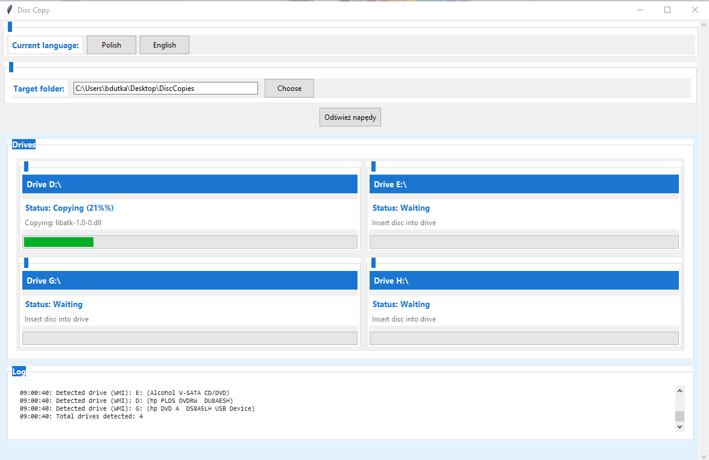

# SmartDiskCopier

SmartDiskCopier is a Windows desktop application for automatically copying
files from optical discs to a selected destination. It can monitor multiple
CD/DVD drives at the same time, including drives redirected through Remote
Desktop, and provides live progress information for each drive.

<div align="center">

[](https://www.microsoft.com/windows)
[](https://www.python.org/)
[](https://opensource.org/licenses/MIT)

</div>

## Features

- Detects physical, network, and RDP-redirected CD/DVD drives.
- Monitors multiple drives concurrently.
- Copies complete disc contents while preserving the directory structure.
- Creates timestamped destination folders containing the drive letter and
  Windows username.
- Shows per-drive status and copy progress in the graphical interface.
- Automatically ejects a disc after copying.
- Supports English and Polish.
- Keeps the application window visible while copying.
- Uses a compact, responsive layout with a dedicated status area and log panel.
- Prevents more than one application instance from running.
- Stores the destination and language in `config.json`.
- Supports both source execution and a standalone PyInstaller executable.

## Requirements

- Windows 10 or newer is recommended.
- Python 3.7 or newer.
- Access to at least one CD/DVD drive, physical or redirected.
- Write access to the selected destination folder.
- Enough free disk space for the copied files.

## Installation

Clone the repository and install the Python dependencies:

```powershell
git clone https://github.com/BartoszDutka/SmartDiskCopier.git
cd SmartDiskCopier
python -m pip install -r requirements.txt
```

## Running from Source

Start the application with:

```powershell
python SmartDiskCopier.py
```

When the application starts, it detects available drives automatically. Choose
the destination folder, insert a disc, and the copy process will begin when
the disc is detected.

The application remains visible while copying. Close it with the **Exit
Program** button or the window close button.

## Building the Executable

Install the dependencies and run the included build script:

```powershell
python build_exe.py
```

The script creates a one-file, windowed executable in the `dist` directory and
copies `config.json` next to it. The configuration file must remain next to
the executable so that settings can be loaded and saved.

The generated executable is intended for Windows and does not require Python
to be installed on the target machine.

## Configuration

Settings are stored in `config.json`:

```json
{
    "target_path": "C:\\\\Users\\\\Public\\\\CopiedDiscs",
    "default_language": "en",
    "version": "1.0.0"
}
```

| Setting | Description |
| --- | --- |
| `target_path` | Root folder where timestamped disc folders are created. Local paths and accessible UNC paths are supported. |
| `default_language` | Startup language: `en` or `pl`. |
| `version` | Configuration version value. |

The destination and language can also be changed in the application. Changes
are saved when the application exits.

## Output Structure

For each detected disc, SmartDiskCopier creates a folder similar to:

```text
<target_path>\
└── Plyta_D_<username>_20250220_103015\
    ├── autorun.inf
    ├── Documents\
    └── ...
```

The folder name includes the source drive letter, the Windows username, and a
timestamp.

## Screenshots

### Main Interface



### Copying Process



## Troubleshooting

### No drive is detected

- Confirm that the drive is visible in Windows File Explorer.
- Check that a disc is inserted and readable.
- For RDP drives, enable local drive redirection in the Remote Desktop
  connection settings.
- Use **Refresh Drives** in the application.

### Copying fails

- Check the disc for damage or read errors.
- Confirm that the destination is reachable and writable.
- Verify that there is enough free disk space.
- For a network destination, check the UNC path and network connection.

## Project Files

| File | Purpose |
| --- | --- |
| `SmartDiskCopier.py` | Main application and copy logic |
| `translations.py` | English and Polish interface translations |
| `config.json` | Runtime configuration |
| `build_exe.py` | PyInstaller build script |
| `SmartDiskCopier.spec` | PyInstaller specification |
| `app_icon.ico` | Application icon |
| `version_info.txt` | Windows executable version metadata |
| `screenshots/` | Application screenshots |

## Contributing

Contributions are welcome:

1. Fork the repository.
2. Create a feature branch:
   `git checkout -b feature/your-feature`.
3. Make and test your changes.
4. Commit the changes.
5. Open a pull request.

## License

This project is released under the MIT License. Add the project license file
to the repository before distributing a licensed release.
